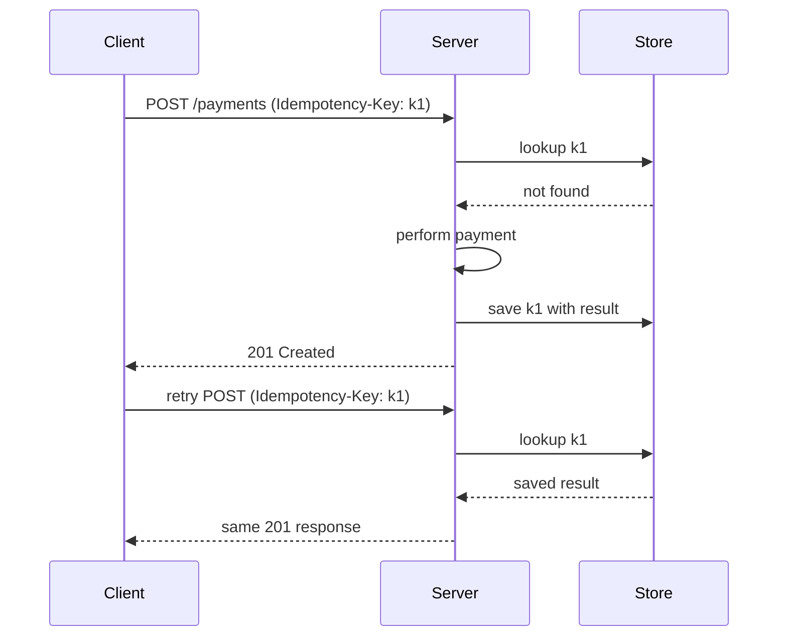

> **Sample entry** for previewing the layout. Replace with your own notes.

## Problem

Networks fail halfway. A client that never saw the response will retry, and the server must not perform the action twice.

## Mechanism

## Rules that keep it correct

1. The client generates the key, once per logical action.
2. The server stores the **result**, not just the fact it happened.
3. Keys expire after a documented window.

## Lessons

- Idempotency belongs in the contract, not as a hope.
- Reusing a key with a different body should be rejected.
