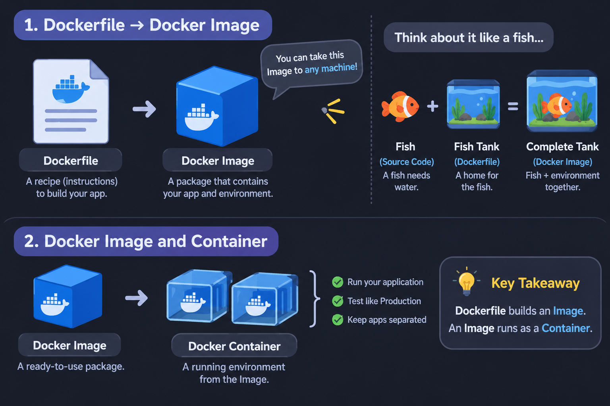
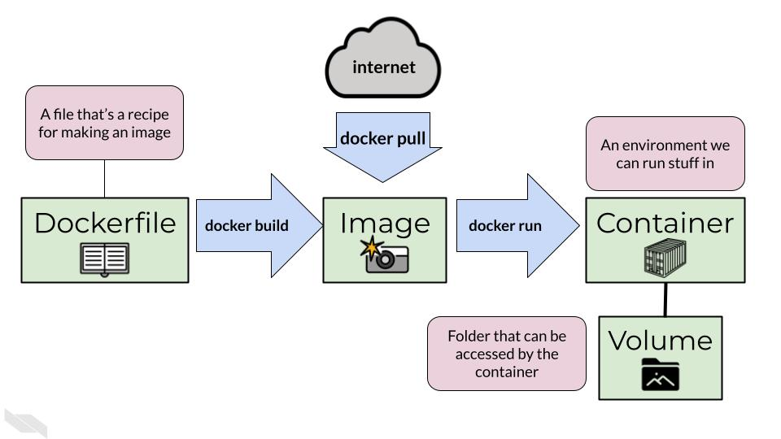
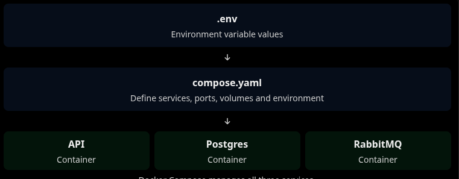
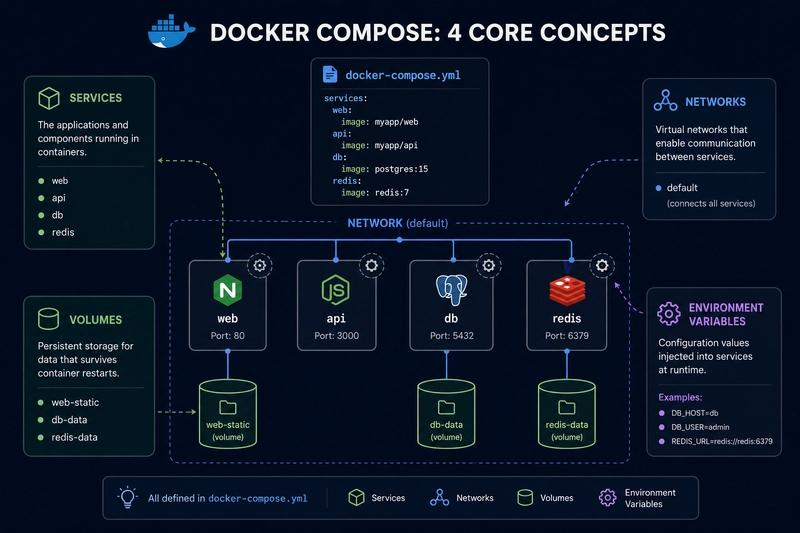
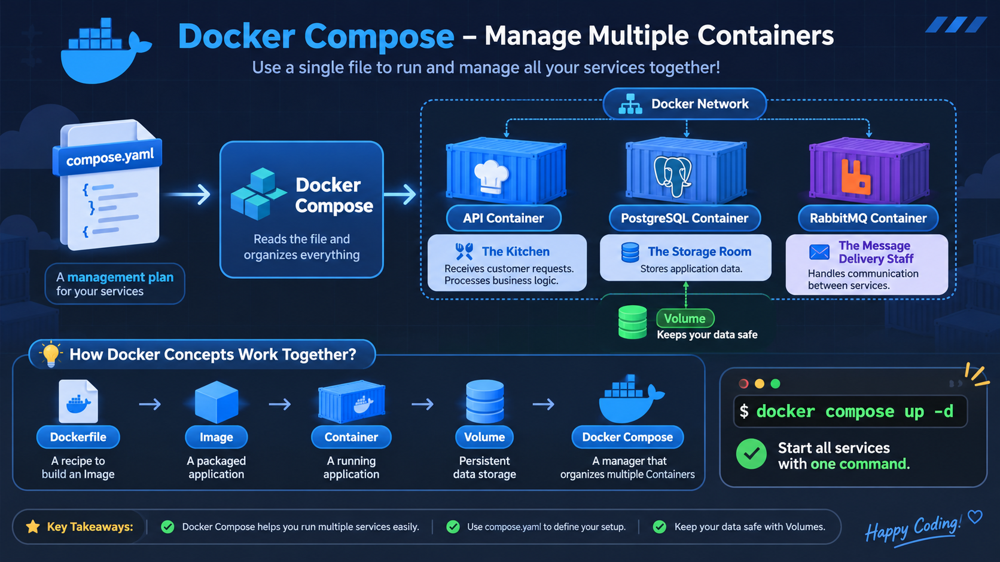
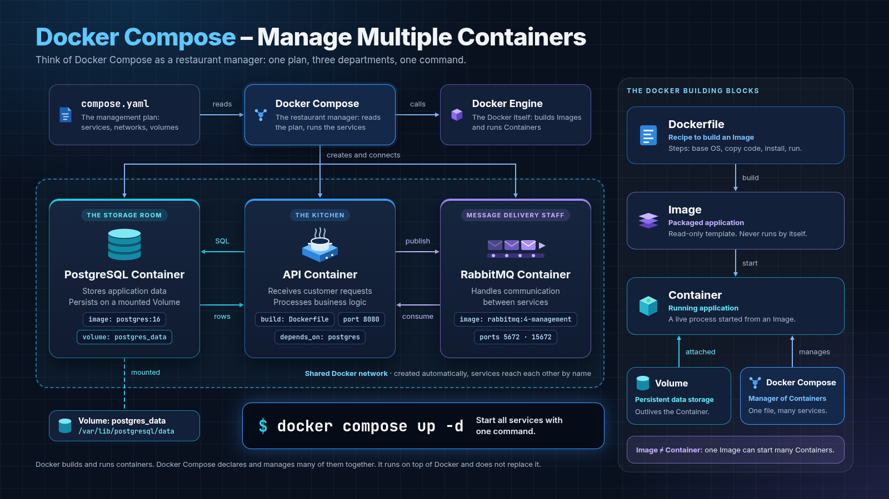

## How do you run EF migrations on Linux?

> [!NOTE]
> I had this problem when I started coding on Linux.
> I currently use .NET for my projects.
> Rider (IntelliJ) works well on Windows, but I can't use it as my main code editor on Linux.
> So, I created this blog to remember useful Linux commands.

### Migration commands

- **Migrations:** Think of migrations as a history of changes in your database, like a diary.
  For example, what changed between the first version and the second version of a database?

```bash
# Create a new migration (Init and Create new)
dotnet ef migrations add Initial --project NameOfProject.Repository --startup-project NameOfProject.API

# Show all migrations
dotnet ef migrations list --project NameOfProject.Repository --startup-project NameOfProject.API

# Apply migrations to the database
dotnet ef database update --project NameOfProject.Repository --startup-project NameOfProject.API

# Go back to an old migration
dotnet ef database update NameOldMigration --project NameOfProject.Repository --startup-project NameOfProject.API

# Remove the last migration
dotnet ef migrations remove --project NameOfProject.Repository --startup-project NameOfProject.API

# !!! Important !!!
# Be careful! This command deletes the database and all its data.
dotnet ef database drop --project NameOfProject.Repository --startup-project NameOfProject.API
```

## Running databases with Docker

Docker is a tool that helps us run databases and applications inside containers.

### 1. Run PostgreSQL with Docker

```bash
# Create a PostgreSQL container
# I'm gonna run the DB on port 5432.
docker run --name my-postgres -e POSTGRES_PASSWORD=MyStrongPassword123@ -d -p 5432:5432 postgres
```

After that, you can connect your application to this database by adding a connection string to `appsettings.json`:

```json
{
  "ConnectionStrings": {
    "DefaultConnection": "Host=localhost;Port=5432;Database=testDb;Username=postgres;Password=MyStrongPassword123@"
  }
}
```

### 2. Run another PostgreSQL database

What if I want to run another database at the same time?

I can use another port, for example, `5433`.

```bash
# Create another PostgreSQL container
# I'm gonna run the DB on port 5433.
docker run --name madUtil-postgres -e POSTGRES_PASSWORD=MyStrongPassword123@ -d -p 5433:5432 postgres
```

Then, change the connection string in `appsettings.json`:

```json
{
  "ConnectionStrings": {
    "DefaultConnection": "Host=localhost;Port=5433;Database=testDbV2;Username=postgres;Password=MyStrongPassword123@"
  }
}
```

> => Now, I have **2 PostgreSQL containers** running independently at the same time.
>
> - First database: `localhost:5432`
> - Second database: `localhost:5433`

## Useful Docker commands on Linux

These are some useful commands you should know when working with Docker on Linux, especially because Linux does not have Docker Desktop by default.

```bash
# Show all containers
docker ps -a

# Show running containers only
docker ps

# Start a container
docker start my-postgres

# Stop a container
docker stop my-postgres
```

## Dockerfile, Docker Image and Docker Container

### What is a Dockerfile?

- A Dockerfile is a file that contains instructions for building and running your application.
- A Dockerfile is used to build a **Docker Image**.
- You can use this **Image** to run your application on different machines.

#### Think about it like a fish tank

Imagine you have a fish.

- **Source code (Fish):** A fish cannot live without water and a suitable environment.
- **Dockerfile (Fish tank):** A fish tank provides everything the fish needs to live.
- **Docker Image (Complete fish tank):** It contains the application and the environment it needs to run.

So, you can take this **Image** to another machine and run it without setting up everything again.

#### Example: from Repository to Container, with a .NET Dockerfile

```text
Repository
    |
    v
Service
    |
    v
API
    |
    v
Dockerfile
    |
    v
Docker Image
    |
    v
Docker Container
```

```dockerfile
FROM mcr.microsoft.com/dotnet/aspnet:8.0 AS base
USER $APP_UID
WORKDIR /app
EXPOSE 8080
EXPOSE 8081

FROM mcr.microsoft.com/dotnet/sdk:8.0 AS build
ARG BUILD_CONFIGURATION=Release
WORKDIR /src
COPY ["NameOfProject.Api/NameOfProject.Api.csproj", "NameOfProject.Api/"]
COPY ["NameOfProject.Service/NameOfProject.Service.csproj", "NameOfProject.Service/"]
COPY ["NameOfProject.Repository/NameOfProject.Repository.csproj", "NameOfProject.Repository/"]
RUN dotnet restore "NameOfProject.Api/NameOfProject.Api.csproj"
COPY . .
WORKDIR "/src/NameOfProject.Api"
RUN dotnet build "NameOfProject.Api.csproj" -c $BUILD_CONFIGURATION -o /app/build

FROM build AS publish
ARG BUILD_CONFIGURATION=Release
RUN dotnet publish "NameOfProject.Api.csproj" -c $BUILD_CONFIGURATION -o /app/publish /p:UseAppHost=false

FROM base AS final
WORKDIR /app
COPY --from=publish /app/publish .
ENTRYPOINT ["dotnet", "NameOfProject.Api.dll"]
```

> Dockerfile builds an Image. An Image runs as a Container.

### Docker Image and Container

- **Docker Image:** A package that contains your application and everything it needs to run.(**Template**)

- **Docker Container:** A running instance of a Docker Image. It provides an isolated environment where you can run and test your application.

  You can use a Container to test your application in an environment similar to Production.

  Multiple applications can run in different Containers at the same time.

  _**Container is an environment created from a Docker Image to run and test your application.**_



---

## Summary: Docker basic concepts

### 1. Dockerfile

- **Technical:**
  - A Dockerfile is a text file without a file extension.
  - It contains a list of instructions that Docker uses to build a Docker Image.

- **Easy to understand:**
  - Think of a Dockerfile as a recipe. It tells Docker what to do step by step:
    - Which operating system to use.
    - Where to copy our source code.
    - Which commands to run, such as `dotnet restore`, `dotnet publish`, or `npm install`.
    - How to prepare our application.

  In short, a Dockerfile is like a recipe for building a Docker Image.

### 2. Docker Image

- **Technical:**
  - An Image is a package that contains our application and everything it needs to run, such as libraries, dependencies, and runtime environments.
  - You can share an Image with other people and run it on different machines.

- **Easy to understand:**
  - Think of an Image as a packaged version of our application.
  - It is a little like the output folder after building our project with commands such as `dotnet publish` or `npm run build`.
  - However, an Image contains more than just our application files. It also includes the environment needed to run the application.

  In short, you can take this Image to another machine and run it without setting up everything again (as long as the machine supports Docker).

### 3. Docker Container

- **Technical:**
  - A Container is an isolated environment created from a Docker Image.
  - You can create multiple Containers from the same Image.
  - Each Container runs independently.

- **Easy to understand:**
  - Think of an Image as a package that is ready to use.
  - When you start that package, Docker creates a Container.
  - The Container is where your application actually runs.

  For example:
  - You can create one Container for development.
  - You can create another Container for testing.
  - Both Containers can use the same Image.

### 4. Docker Volume

- **Technical:**
  - A Volume is a way to store data outside a Container's writable layer.
  - It helps keep important data even when a Container is removed.

- **Easy to understand:**
  - Imagine you have a PostgreSQL Container that stores your database.
  - What happens if you remove that Container? Data stored only inside the Container will be lost.
  - A Volume helps keep your important data even when the Container is removed.

  For example:
  - Database data.
  - Application logs.
  - Uploaded files and images.

  You can remove an old Container and create a new one while keeping the data stored in the Volume.

### 5. Summary: how they fit together

```text
Dockerfile
    |
    | Build
    v
Docker Image
    |
    | Run
    v
Docker Container
    |
    | Store persistent data
    v
Docker Volume
```

**Remember:**

- Dockerfile = Instructions to build an Image.
- Image = A package containing the application and its environment.
- Container = An isolated environment where the application runs.
- Volume = A place to keep data when a Container is removed.



| Dockerfile builds an Image. An Image runs as a Container. A Volume keeps your data safe.

## Docker Compose: manage multiple containers

### 1. What is Docker Compose?

- **Technical:**
  - Docker Compose is a tool that helps you manage multiple Docker Containers at the same time.
  - You can define all your services, networks, volumes, and environment variables in one file called `compose.yaml` or `docker-compose.yml`.
  - You don't need to run each Container manually with separate commands.

- **Easy to understand:**
  - Imagine you have a .NET project with:
    - API
    - PostgreSQL
    - RabbitMQ

  Normally, you need to run each Container separately.

  But with Docker Compose, you can put everything into one file and start all Containers with just one command.

  In short, Docker Compose helps you manage your entire application in one place.

### 2. How does it work?

Think about it like this:

```text
             compose.yaml
                  |
                  v
             Docker Compose
                  |
          +-------+-------+
          |       |       |
          v       v       v
         API   PostgreSQL RabbitMQ
          |       |       |
          v       v       v
       Container Container Container
```

### 3. Example: .NET + PostgreSQL + RabbitMQ

Create a file named `compose.yaml` in your project root.

```text
MyProject/
├── Dockerfile
├── compose.yaml
├── .env
├── .gitignore
└── src/
    ├── API/
    ├── Service/
    └── Repository/
```

#### Step 1: Create environment variables

Create a file named `.env`:

```env
# PostgreSQL configuration
POSTGRES_USER=postgres
POSTGRES_PASSWORD=MyStrongPassword123@
POSTGRES_DB=testDb
POSTGRES_PORT=5432

# API configuration
ASPNETCORE_ENVIRONMENT=Development
```

#### Step 2: Configure Docker Compose

Open `compose.yaml`:

```yaml
services:
  api:
    build:
      context: .
      dockerfile: Dockerfile
    ports:
      - '8080:8080'
    environment:
      ASPNETCORE_ENVIRONMENT: ${ASPNETCORE_ENVIRONMENT}
      ConnectionStrings__DefaultConnection: 'Host=postgres;Port=5432;Database=${POSTGRES_DB};Username=${POSTGRES_USER};Password=${POSTGRES_PASSWORD}'
    depends_on:
      - postgres

  postgres:
    image: postgres:16
    environment:
      POSTGRES_USER: ${POSTGRES_USER}
      POSTGRES_PASSWORD: ${POSTGRES_PASSWORD}
      POSTGRES_DB: ${POSTGRES_DB}
    ports:
      - '${POSTGRES_PORT}:5432'
    volumes:
      - postgres_data:/var/lib/postgresql/data

  rabbitmq:
    image: rabbitmq:4-management
    ports:
      - '5672:5672'
      - '15672:15672'

volumes:
  postgres_data:
```

#### Step 3: Understand environment variables

There are two important things you should understand:

**1. `.env`**

- This file stores environment variable values.
- Docker Compose reads these values and replaces `${VARIABLE}` in `compose.yaml`.

**2. `environment`**

- This is where you pass environment variables into a Container.
- Your application can read these values when it runs.

For example:

```yaml
environment:
  ASPNETCORE_ENVIRONMENT: ${ASPNETCORE_ENVIRONMENT}
```

This means Docker Compose reads `ASPNETCORE_ENVIRONMENT` from `.env` and passes it into the API Container.

**Important for .NET:**

In .NET, you can use `__` (double underscore) to replace `:` in configuration keys.

For example:

```text
ConnectionStrings:DefaultConnection
```

Becomes:

```text
ConnectionStrings__DefaultConnection
```

This allows your API to read the connection string from environment variables instead of hardcoding it in `appsettings.json`.

### 4. How can API connect to PostgreSQL?

When API and PostgreSQL run inside Docker Compose, they can communicate with each other using service names.

For example, our PostgreSQL service name is `postgres`.

So, the connection string will be:

```json
{
  "ConnectionStrings": {
    "DefaultConnection": "Host=postgres;Port=5432;Database=testDb;Username=postgres;Password=MyStrongPassword123@"
  }
}
```

**Why do we use `postgres` instead of `localhost`?**

- `localhost` means the current Container.
- `postgres` is the PostgreSQL service name in `compose.yaml`.
- Docker Compose automatically creates a network so Containers can communicate with each other.

Think about it like this:

```text
API Container
     |
     | Host=postgres
     |
     v
PostgreSQL Container
```

### 5. Useful Docker Compose commands

```bash
# Start all Containers
docker compose up -d
# up = Start services.
# -d = Run in background. (Detached Mode)

# Build Images and start Containers
docker compose up -d --build

# Check running Containers
# ps: process status
docker compose ps

# Show logs
docker compose logs

# Show logs of one service
docker compose logs api

# Follow logs in real time
# -f: Follow
docker compose logs -f api

# Check the final Compose configuration
docker compose config

# Stop all Containers
docker compose stop

# Stop and remove Containers
docker compose down

# Remove Containers and Volumes
# !!! WARNING !!! This will delete persisted database data.
# -v = Volume
docker compose down -v
```

### 6. Docker vs Docker Compose

| Docker                     | Docker Compose                  |
| -------------------------- | ------------------------------- |
| Run individual Containers  | Manage multiple Containers      |
| Use `docker run`           | Use `docker compose up`         |
| Configure through commands | Configure through YAML          |
| Good for simple tests      | Good for multi-service projects |

### 7. Important: Protect your environment variables

If your `.env` file contains passwords or other sensitive information, you should not upload it to GitHub.

Add `.env` to your `.gitignore`:

```gitignore
.env
```

You can create a `.env.example` file to show other developers which variables they need to configure:

```env
POSTGRES_USER=
POSTGRES_PASSWORD=
POSTGRES_DB=
POSTGRES_PORT=5432

ASPNETCORE_ENVIRONMENT=Development
```

### 8. Summary: Docker Compose

- **Docker:** Helps you create and run Containers.
- **Docker Compose:** Helps you manage multiple Containers together.
- **compose.yaml:** Defines how your application and its services should run.
- **.env:** Stores environment variable values.
- **environment:** Passes environment variables into Containers.
- **Volume:** Helps keep your database data even when a Container is removed.

**Remember:**

Docker Compose allows you to start your entire application with just one command:

```bash
docker compose up -d
```






## Benefits of Docker

### 1. Consistent Environment

- Define the environment once and run it on Windows, macOS, and Linux.
- Everyone uses the same software versions.

=> **Define once, run anywhere.**

### 2. Isolation

- Each project runs in its own Containers.
- Different projects can use different software versions without conflicts.

Example: Project A uses PostgreSQL 16, while Project B uses PostgreSQL 18.

=> **Projects don't interfere with each other.**

### 3. Easy Handover

- Share Docker configuration files instead of long setup instructions.
- New developers can start the environment with one command.

```bash
docker compose up -d
```

=> **Easy to share and set up.**

### 4. Self-Healing

- Docker can automatically restart Containers when they stop unexpectedly.
- Requires a restart policy.

=> **Automatically restart after unexpected failures.**
