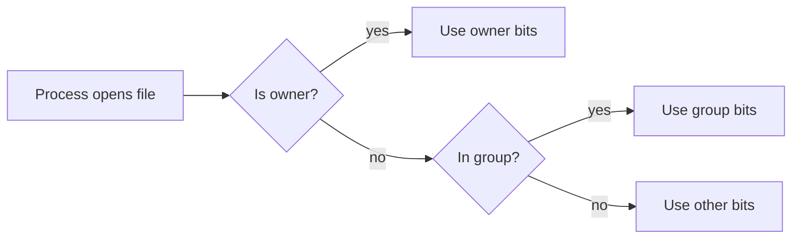

> This is a **sample entry** that shows the layout. Replace it with your own notes.

## Context

Every file on Linux has an owner, a group and three permission sets. Understanding them removes most "permission denied" surprises.

## Reading `ls -l`

```bash
ls -l notes.txt
# -rw-r--r-- 1 hao users 120 Oct  2 09:00 notes.txt
```

The first column is `-rw-r--r--`: file type, then owner, group and others, each as `rwx`.

| Bits  | Octal | Meaning              |
| ----- | ----- | -------------------- |
| `rwx` | 7     | read, write, execute |
| `r-x` | 5     | read and execute     |
| `r--` | 4     | read only            |

## Changing them

```bash
chmod 640 notes.txt   # owner rw, group r, others none
chmod +x script.sh    # add execute for everyone
```

## How a check flows



## Lessons

- Prefer `640` or `600` for anything personal.
- `x` on a directory means "may enter it".
