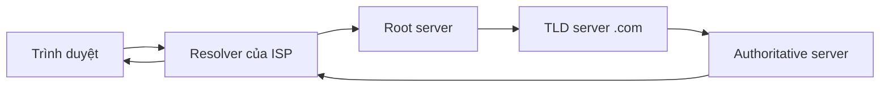

> Đây là **bài mẫu** để xem bố cục. Hãy thay bằng ghi chú của bạn.

## Bối cảnh

Máy tính nói chuyện bằng địa chỉ IP, còn con người nhớ tên miền. DNS là cuốn danh bạ nối hai thứ đó.

## Các bước tra cứu



1. Trình duyệt hỏi **resolver** (thường do nhà mạng cung cấp).
2. Resolver hỏi **root** để biết ai quản lý `.com`.
3. **TLD server** chỉ tới máy chủ quản lý tên miền cụ thể.
4. **Authoritative server** trả về địa chỉ IP, kèm TTL để lưu đệm.

## Thử bằng dòng lệnh

```bash
dig +trace example.com
dig example.com A +short
```

## Bài học

- Hầu hết các lần tra cứu được trả lời từ bộ nhớ đệm, nên đổi bản ghi DNS thường không có hiệu lực ngay.
- Muốn đổi nhanh, hãy hạ TTL **trước** khi thay đổi.
