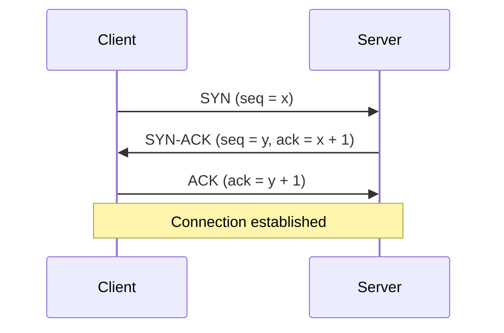

> **Sample entry** for previewing the layout. Replace with your own notes.

## Why a handshake

TCP promises ordered, reliable delivery. Before it can promise that, both sides must agree on starting sequence numbers.

## The three steps



| Step | Flags     | Meaning                             |
| ---- | --------- | ----------------------------------- |
| 1    | `SYN`     | Client proposes a starting sequence |
| 2    | `SYN,ACK` | Server accepts and proposes its own |
| 3    | `ACK`     | Client confirms, data may now flow  |

## Watching it happen

```bash
sudo tcpdump -nn -i any 'tcp[tcpflags] & (tcp-syn|tcp-ack) != 0' and port 443
```

## Lessons

- A flood of `SYN` without the final `ACK` is a classic resource-exhaustion attack, which is why servers use SYN cookies.
- Each handshake costs one round trip, so reusing connections matters for latency.
