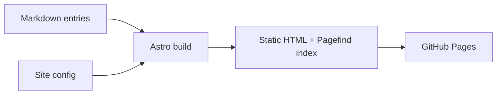

> **Sample entry**, but accurate to how this site is built.

## Goal

A long-lived place for notes that stays cheap to host and easy to move.

## Shape of the system

## Decisions

| Decision  | Chosen                 | Why                                    |
| --------- | ---------------------- | -------------------------------------- |
| Rendering | Static generation      | No server to run or secure             |
| Content   | Markdown + collections | Typed, validated, portable             |
| Search    | Pagefind               | Works offline on a static site         |
| Styling   | Tokens + Tailwind      | One place for colour, type and spacing |

## What was left out

- No database, no accounts, no analytics.
- No comments, because every feature should serve the archive.

## Lessons

- A cache of rendered content can hide a config change; clear it when markdown settings move.
- Write the content schema before the first page.
