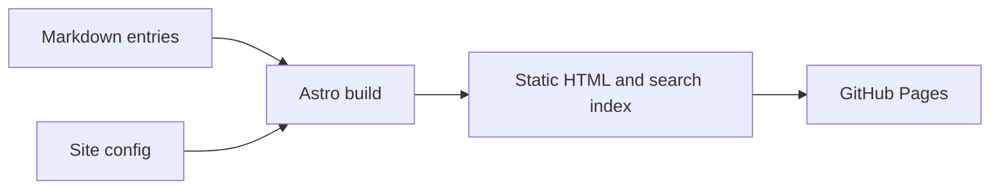

> **Sample project** that happens to describe this very site accurately. Edit or replace it.

## Why it exists

Notes that stay in scattered files rarely get read twice. This archive keeps what I learn in one place, written so that it can be read again later.

## Core capabilities

- Static output, hosted on GitHub Pages with no server to run.
- Markdown entries validated by a typed schema.
- Full-text search that works offline (Pagefind).
- Dark and light modes derived from one token file.
- Diagrams written as Mermaid code blocks.

## Structure



```text
src/
  content/     knowledge and projects, as Markdown
  config/      site.ts, the one place for personal settings
  styles/      tokens.css, global.css, prose.css
  utils/       small pure functions, each with a test
```

## Trade-offs

| Choice               | Gain                          | Cost                          |
| -------------------- | ----------------------------- | ----------------------------- |
| Static generation    | Cheap, fast, nothing to patch | No server-side features       |
| One monospace family | A consistent voice            | Long text is wider than serif |

## What comes next

Learning paths and a journal, once there is enough content to justify them.
